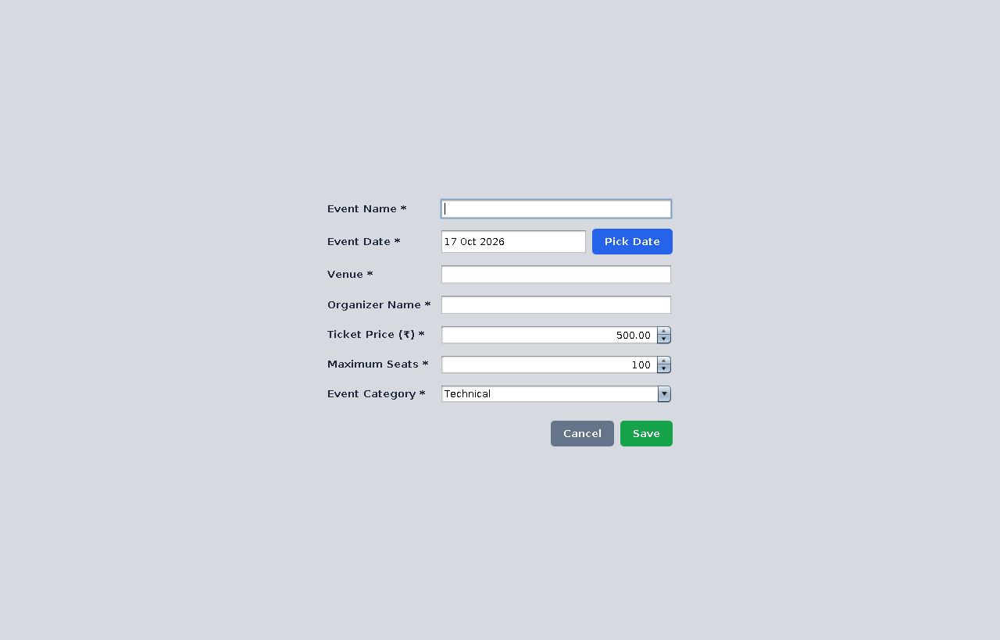
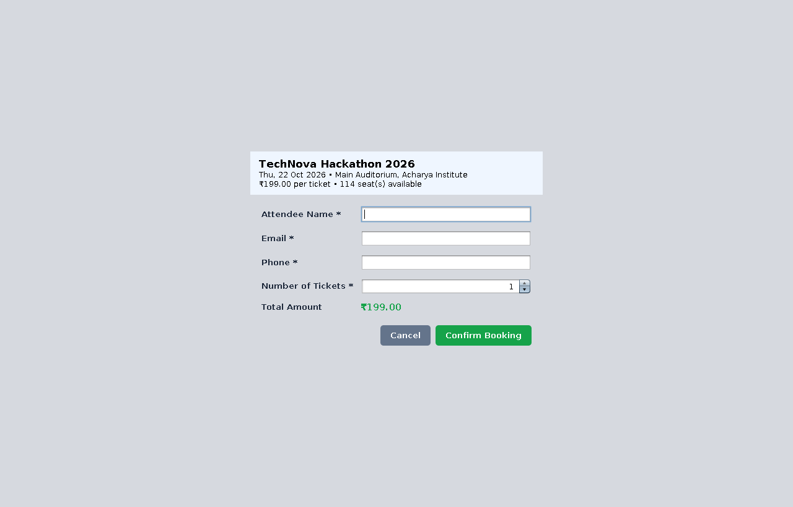

# 🎟️ Event Registration and Ticketing System

A desktop application built with **Java Swing**, **JDBC** and **MySQL** that helps organizers manage events, register attendees, generate ticket confirmations and track seat availability in real time.

   

## 📸 Screenshots

| Dashboard | Add / Edit Event |
|---|---|
|  |  |

| Register Participant | Ticket Confirmation |
|---|---|
|  |  |

## ✨ Features

- **Event management (CRUD):** add, view, update and delete events (name, date, venue, organizer, ticket price, maximum seats, category).
- **Events table (`JTable`):** click any column header to sort; search by name, venue or organizer; filter by category.
- **Participant registration:** capture name, email, phone and number of tickets; a ticket confirmation is generated automatically and can be saved as a `.txt` file.
- **Seat tracking:** total, booked and available seats per event, shown in the table and in a colour-coded availability bar.
- **Overbooking prevention:** seat availability is re-checked inside a database transaction with a row lock.
- **Dashboard stats:** total events, upcoming events, total seats, seats booked and revenue.
- **Attendee report:** view attendees per event and export to CSV.
- **Offline fallback:** if MySQL is unavailable the app still opens using local file storage.

## 🧰 Tech Stack

| Layer | Technology |
|---|---|
| Language | Java 17+ |
| GUI | Java Swing (Nimbus look and feel, custom components) |
| Database | MySQL 8 via JDBC (`PreparedStatement` everywhere) |
| Driver | MySQL Connector/J |
| Architecture | MVC (Model / View / Controller / DAO) |

## 🚀 Getting Started

### Prerequisites
- JDK 17 or newer
- VS Code with the **Extension Pack for Java** (or any Java IDE)
- MySQL 8 (optional, see below)

### Run in VS Code
1. Clone the repository:
   ```bash
   git clone <your-repo-url>
   cd EventTicketingSystem
   ```
2. Open the folder in VS Code.
3. Open `src/com/eventticketing/Main.java` and click **Run** (or press `F5`).

The dashboard opens with sample data. Without MySQL, the header badge shows **Offline mode: local storage**.

### Run from the command line
```bash
# Windows
run.bat

# macOS / Linux
./run.sh
```

### Connect to MySQL
1. Start your MySQL server.
2. Download **MySQL Connector/J** (Platform Independent) and copy the `.jar` into the `lib/` folder.
3. Edit `config.properties`:
   ```properties
   db.mode=auto
   db.url=jdbc:mysql://localhost:3306/event_ticketing?createDatabaseIfNotExist=true&useSSL=false&allowPublicKeyRetrieval=true&serverTimezone=UTC
   db.user=root
   db.password=your_password
   ```
4. Run the app again. The badge turns green (**MySQL · event_ticketing**) and the database and tables are created automatically. `sql/schema.sql` is included for reference.

`db.mode` options: `auto` (MySQL if reachable, else offline), `mysql` (MySQL only), `local` (never use MySQL).

## 🗄️ Database Design

**`events`**

| Column | Type | Notes |
|---|---|---|
| id | INT (PK, AI) | Event ID |
| event_name | VARCHAR(255) | Event name |
| event_date | DATE | Scheduled date |
| venue | VARCHAR(255) | Event venue |
| organizer_name | VARCHAR(255) | Organizer |
| ticket_price | DECIMAL(10,2) | Ticket amount |
| maximum_seats | INT | Total capacity |
| event_category | VARCHAR(100) | Event type |

**`participants`** (registrations): `id`, `event_id` (FK → events, `ON DELETE CASCADE`), `attendee_name`, `email`, `phone`, `seats`, `amount_paid`, `booked_at`.
Booked seats for an event = `SUM(seats)` of its participants.

## ✅ Validation Rules

- Name, venue, organizer and category are required; price ≥ 0; seats ≥ 1.
- Event date cannot be in the past.
- Only one event per venue per day.
- Maximum seats cannot be reduced below the seats already booked.
- Valid email and phone required for registration; up to 10 tickets per booking.
- Registration is blocked for sold-out and completed events.

## 📁 Project Structure

```
EventTicketingSystem/
├── src/com/eventticketing/
│   ├── Main.java                  # entry point
│   ├── model/                     # Event, Participant
│   ├── view/                      # MainFrame, EventDialog, RegisterDialog,
│   │                              # TicketDialog, AttendeesDialog, DatePickerField ...
│   ├── controller/                # EventController (validation + business rules)
│   ├── dao/                       # EventRepository, JdbcEventRepository,
│   │                              # LocalEventRepository, RepositoryFactory
│   └── util/                      # Ui, TicketFormatter, SampleData, AppException
├── lib/                           # place MySQL Connector/J jar here
├── sql/schema.sql                 # table definitions
├── config.properties              # database settings
├── run.bat / run.sh               # run without an IDE
└── docs/screenshots/              # README images
```

## 🔮 Future Enhancements

- PDF e-tickets (Apache PDFBox / iText)
- QR-code based event entry (ZXing)
- Email / SMS ticket confirmations
- Payment gateway integration
- Attendee analytics with charts

## 👩‍💻 Author

**Ajitha**: Computer Science Engineering, Acharya Institute of Technology (VTU), Bengaluru.

## 📄 License

This project was built for academic purposes. Add a license of your choice (for example MIT) if you plan to share it publicly.
